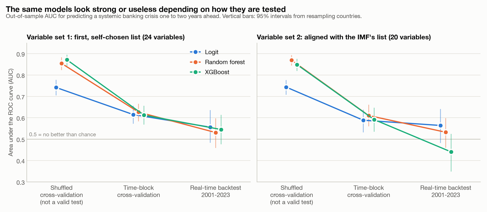
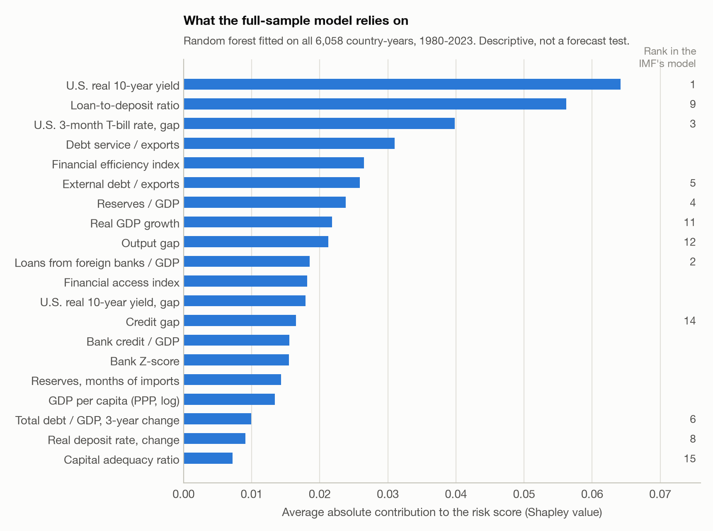
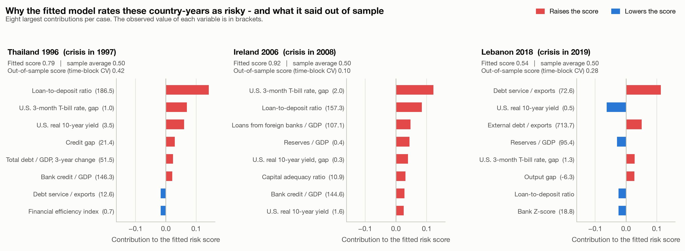

# Can public data predict banking crises? A replication of the IMF's machine-learning approach

This project rebuilds, from public data only, the kind of model the IMF uses to assess the risk of
systemic banking crises (the financial sector model of its Vulnerability Exercise), and tests how
well it predicts crises one to two years ahead.

**Result.** The models do not predict crises in a real-time test. Their out-of-sample AUC is
0.42 to 0.56, which is not distinguishable from chance, and tree-based models do no better than
a logit. The same random forest and XGBoost models reach an AUC of 0.85 to 0.87 under ordinary
shuffled cross-validation.
The gap comes from the test design, not from the models: shuffled folds let a model see the
crisis it is being tested on.



## Results

Out-of-sample AUC for predicting a crisis that starts in the next two years. 0.5 is chance.

| Model | Shuffled CV (invalid), set 1 | set 2 | Time-block CV, set 1 | set 2 | Real-time backtest, set 1 | set 2 |
|---|---|---|---|---|---|---|
| Rule of thumb | 0.585 | 0.585 | 0.364 | 0.364 | 0.418 | 0.418 |
| Logit | 0.742 | 0.744 | 0.615 | 0.588 | 0.556 | 0.564 |
| Random forest | 0.855 | 0.869 | 0.626 | 0.610 | 0.531 | 0.532 |
| Balanced random forest | 0.804 | 0.818 | 0.633 | 0.600 | 0.508 | 0.423 |
| XGBoost | 0.871 | 0.849 | 0.612 | 0.592 | 0.545 | 0.440 |

Confidence intervals, sub-period results and Brier scores are in `output/model_comparison.csv`.
In the backtest every model's 95% interval includes 0.5 or lies below it.

The three designs:

- **Real-time backtest.** To predict from year T, train on years up to T-2, for T = 2001 to 2023.
  The two-year gap is needed because the outcome of a row from year T-1 is not known until T+1.
  3,499 predictions covering 44 crises.
- **Time-block cross-validation.** Hold out each 5-year block in turn, drop the two years on
  either side, train on the rest. Not a real-time test, but no crisis is on both sides of a split.
  The IMF uses this kind of check to complement its backtest.
- **Shuffled cross-validation.** Rows split at random into five folds. Reported only as a
  reference point: the two pre-crisis years of one crisis land in different folds, and so do
  countries hit by the same global wave in the same year.

Two variable sets were tried. Set 1 (24 variables) was chosen from the general early-warning
literature. Set 2 (20 variables) was built afterwards, once set 1 had been backtested, and
follows the IMF's published variable list wherever public data exist (20 of its 31 variables).
Both use the same 6,058 country-years. They give the same answer, and no further variables or
models were tried after that, because adjusting a model until its test results improve is
selecting on the test data.

## Why the backtest fails

The crises in the test period are a different kind from those the models were trained on.

- Of the 100 crises in the first training window (to 1999), 78 were in countries that are not
  high-income today. Of the 44 crises in the test period, 24 start in 2007 or 2008, and 21 of
  those are in high-income countries. The models learned the pattern of the earlier crises -
  inflation, depreciation, low reserves - and ranked advanced economies as the safest.
- Several variables point in opposite directions in the two periods. The three-year change in
  bank credit to GDP has a single-variable AUC of 0.48 before 2000 and 0.76 after. Inflation goes
  from 0.65 to 0.47. Seven variables in set 1 are on opposite sides of 0.5 in the two periods.

The IMF's technical note makes the same two observations about its own model: crises before
2000 were mostly in emerging and low-income countries and later ones in advanced economies, and
a backtest "risks evaluating the model exclusively on its performance on a single event".

## What the fitted model relies on

A random forest fitted on the whole sample, decomposed with Shapley values. This describes the
patterns in the data from 1980 to 2023; it is not evidence that they forecast.



The ranking overlaps with the one the IMF reports: the U.S. real 10-year yield is first in
both, and the U.S. T-bill rate gap, reserves to GDP and external debt to exports are in the top
seven of both. The model also reproduces the interaction the IMF highlights: external debt adds
more to the risk score when U.S. real rates are high (`output/shap_interaction_v2.png`).



The case panels show the limit of this kind of evidence. The fitted model gives Ireland in 2006
a score of 0.92; the time-block model, which had not seen 2005-2009, gave it 0.10.

## Data

All data are public. Every raw file is listed in `data/raw/MANIFEST.csv` with its URL, vintage,
retrieval time and SHA-256 checksum, and `src/download_data.py` re-creates them.

| Source | Content | Vintage |
|---|---|---|
| Laeven and Valencia (2026), IMF WP 2026/094 | Systemic banking crisis dates, 164 episodes, 1970-2025 | 2026 edition, extracted from the paper's Table A1 |
| World Bank WDI | 30 macroeconomic and financial series | Last updated 2026-11-11 |
| IMF World Economic Outlook | 44 series; projections are flagged and excluded | October 2026 |
| IMF Global Debt Database | Private and public debt, 10 series | September 2025 |
| World Bank Global Financial Development Database | Loan-to-deposit ratio, capital adequacy, bank Z-score, loans from foreign banks | September 2022 (final update; ends 2021) |
| IMF Financial Development Index | Access and efficiency sub-indices | As mirrored by DBnomics, June 2024 (ends 2021) |
| FRED | U.S. interest rates, credit spread, VIX, oil price | Retrieved 2026-11-17 |

The data are stored in a DuckDB database with a star layout: `dim_country`, `dim_series`,
`fact_country_year` (613,238 observations keyed by country, year and series), `fact_global_year`
and `crisis_episode`. Primary and foreign keys are enforced by the database.

Sample: 163 countries, predictor years 1980-2023. After removing years during a crisis and
country-years with more than half of the predictors missing, 6,058 rows remain, 281 of them
(4.6%) followed by a crisis within two years, covering 144 crises.

`docs/data_dictionary.md` lists every series, both variable sets with their transformations,
the quality checks, and each decision with its reason.

## Checks against leakage

- Every prediction in the backtest comes from a model trained on years at least two before it.
- With the training labels shuffled, the backtest AUC falls to between 0.39 and 0.59.
- Medians for filling gaps, winsorising cut-offs and scaling are computed inside each training
  window.
- Trend gaps (credit, output, interest rates) use a one-sided HP filter: the trend in year t is
  estimated on data up to year t.
- Hyperparameters are tuned once, on data up to 1999, and then kept fixed.

## Limitations

- Eleven of the IMF's 31 variables could not be reproduced: default probabilities for banks and
  firms, the sub-investment-grade share of corporate debt, house prices, the equity price gap,
  central bank liquidity support and two government bond yield variables. Some of the most
  specifically financial indicators are among them.
- Year-t data are used to predict crises in t+1 and t+2, as in the IMF's models. Annual data for
  year t are published during t+1 and later revised, and the data here are the latest vintage,
  so even the backtest is more favourable than a true real-time exercise.
- Fourteen crises have no usable row before them, mostly in transition economies whose data
  begin in the year of the crisis.
- Three of the four crises since 2018 (Nicaragua 2018, Vietnam 2022, Sri Lanka 2023) are
  classified as borderline by the authors of the crisis database; they are counted as crises here.
- Three start years differ between Table 1 and Table A1 of the crisis paper (Angola, Republic of
  Congo, Ghana). Table A1 is used.
- The two financial-development sources end in 2021, so their variables are imputed for 2022-23.
- The IMF's sample has 117 countries and its list is not published; this one has 163.

## Reproduce

Python 3.13. From the project root:

```bash
python3 -m venv .venv && .venv/bin/python -m pip install -r requirements.txt
bash src/setup_xgboost_macos.sh                 # macOS only
.venv/bin/python src/download_data.py all       # raw data and manifest
.venv/bin/python src/check_raw.py               # verify downloads against the manifest
.venv/bin/python src/build_country_crosswalk.py # country codes across sources
.venv/bin/python src/extract_lv2026_episodes.py # crisis dates from the paper's PDF
.venv/bin/python src/build_long_table.py        # one tidy table of all series
.venv/bin/python src/build_database.py          # DuckDB database, quality checks, data dictionary
.venv/bin/python src/build_features.py v1       # model table, variable set 1
.venv/bin/python src/build_features.py v2       # model table, variable set 2
.venv/bin/python src/run_backtest.py            # the three evaluations, both sets (about 4 minutes)
.venv/bin/python src/explain.py                 # Shapley values
.venv/bin/python src/make_figures.py            # figures
.venv/bin/python src/export_powerbi.py          # tables for the dashboard
```

A later download will differ from the one used here because the sources are revised. To use a
new download, change the folder names under `[vintages]` in `config.toml`; earlier downloads stay
on disk.

## Layout

```
config.toml              vintages in use; sample and label definitions
data/reference/          hand-written inputs: country aliases, variable lists, decisions, crisis table
data/raw/MANIFEST.csv    provenance of every raw file (the files themselves are not in the repository)
docs/data_dictionary.md  generated: series, variables, decisions, quality checks
docs/powerbi_guide.md    how to build the dashboard from output/powerbi/ (in Chinese)
output/                  metrics, figures, and the dashboard tables
src/                     one script per step, in the order listed above
```

## References

- International Monetary Fund (2021). *How to Assess Country Risk: The Vulnerability Exercise
  Approach Using Machine Learning.* Technical Notes and Manuals 21/03.
- Laeven, L., and F. Valencia (2026). *Systemic Banking Crises Database: 1970-2025.* IMF Working
  Paper 2026/094.
- Hellwig, K.-P. (2021). *Predicting Fiscal Crises: A Machine Learning Approach.* IMF Working
  Paper 21/150.
